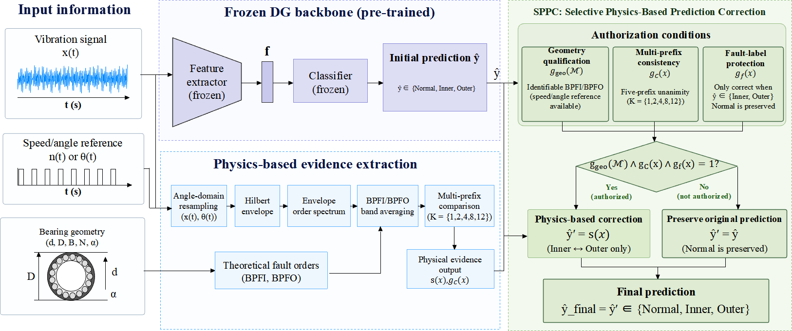

# SPPC: Selective Physics-Based Prediction Correction

**Selective Physics-Based Prediction Correction for Cross-Machine Bearing Fault Diagnosis**

*A training-free, post-hoc approach to correcting inner-race/outer-race fault confusion using bearing-specific physical evidence.*

> ⚠️ **Release Status:** This repository currently serves as a project overview. The source code, pre-trained weights, and reproduction instructions are being organized and will be officially released upon the acceptance of the manuscript. 

## 📖 Overview

Deep learning models for bearing fault diagnosis can struggle when deployed on machines that differ from those seen during training. A particularly important error occurs when a model correctly identifies a faulty bearing but confuses an **inner-race fault (Inner)** with an **outer-race fault (Outer)**.

SPPC addresses this fault-location confusion **after** a diagnostic model has made its prediction. Rather than retraining the model or replacing its three-class decision, SPPC uses an independent signal-processing branch to determine whether the predicted fault location should be revised. The original prediction is retained whenever the required physical information is unavailable or the physical decisions are inconsistent.

## 🛠️ Framework

  
   
  <em>Figure 1: Overall framework of the proposed SPPC method.</em>

 

## 🧠 Method

SPPC combines three key elements:

1. **Bearing-specific physical evidence.** Given validated bearing geometry and a usable speed/angle reference, SPPC constructs an envelope order spectrum and evaluates candidate bands around the BPFI and BPFO harmonics. Band-averaged spectral amplitudes reduce the scoring bias caused by different numbers of spectral bins.
2. **Multi-harmonic comparisons.** Physical evidence is accumulated across harmonics, with decisions evaluated at the fixed prefix set **K = {1, 2, 4, 8, 12}**.
3. **Selective correction.** A physical decision can replace the original Inner/Outer prediction only when the required physical-information conditions hold and all five prefix decisions agree. Otherwise, the original prediction is retained. Predictions of **Normal** are strictly preserved.

## 📊 Experimental Evaluation

We evaluate SPPC in two distinct settings:

| Evaluation | Datasets / Model | Main Result |
| :--- | :--- | :--- |
| **Development & Analysis** | CWRU, UOTTAWA, MFPT, DZLRSB; six frozen backbones | Mean accuracy across four domains and six backbones: **65.39% → 92.82%** |
| **Independent Validation** | Paderborn; frozen CDDG backbone | Class-balanced, bearing-equal window accuracy: **40.13% → 42.87%** |

The development datasets were used to establish the method. **Paderborn was strictly reserved for validation after the SPPC rules and parameters were fixed.**

## 💻 Code and Data Availability

*   **Code:** The SPPC implementation is **not yet available** in this repository. The release is intended to include the physical correction module, experiment configurations, and instructions for reproducing the results. This section will be updated when materials are ready.
*   **Data:** The bearing datasets (CWRU, UOTTAWA, MFPT, DZLRSB, Paderborn) are provided by their original maintainers and are not redistributed here.

## 📝 Paper and Citation

**Manuscript:** *Selective Physics-Based Prediction Correction for Cross-Machine Bearing Fault Diagnosis*

The paper link and BibTeX citation will be added when the manuscript is publicly available.

## 📄 License

The source code of this project will be open-sourced under the **MIT License** upon official release.
