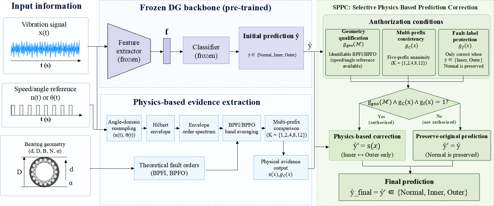

# SPPC

**Selective Physics-Based Prediction Correction for Cross-Machine Bearing Fault Diagnosis**

*A training-free, post-hoc approach to correcting inner-race/outer-race fault confusion using bearing-specific physical evidence.*

> **Release status:** This repository currently contains the project overview only. The source code, configurations, and reproduction instructions have not yet been released.

## Overview

Deep learning models for bearing fault diagnosis can struggle when deployed on machines that differ from those seen during training. A particularly important error occurs when a model correctly identifies a faulty bearing but confuses an **inner-race fault (Inner)** with an **outer-race fault (Outer)**.

SPPC addresses this fault-location confusion **after** a diagnostic model has made its prediction. Rather than retraining the model or replacing its three-class decision, SPPC uses an independent signal-processing branch to determine whether the predicted fault location should be revised. The original prediction is retained whenever the required physical information is unavailable or the physical decisions are inconsistent.

## Framework

*SPPC framework figure — to be added.*

<!--
To insert the final framework figure:
1. Upload the image to assets/sppc_framework.png
2. Replace the italic placeholder above with:

No other README changes are needed.
-->

## Method

SPPC combines three elements:

1. **Bearing-specific physical evidence.** Given validated bearing geometry (or known theoretical characteristic orders) and a usable speed/angle reference, SPPC constructs an envelope order spectrum and evaluates candidate bands around the BPFI and BPFO harmonics. Band-averaged spectral amplitudes reduce the first-order scoring bias caused by different numbers of spectral bins.
2. **Multi-harmonic comparisons.** Physical evidence is accumulated across harmonics, with decisions evaluated at the fixed prefix set **K = {1, 2, 4, 8, 12}**.
3. **Selective correction.** A physical decision can replace the original Inner/Outer prediction only when the required physical-information conditions hold and all five prefix decisions agree. Otherwise, the original prediction is retained. Predictions of **Normal** are never changed.

The physical-information eligibility conditions rely on available, validated machine information; they do not constitute an online detector of incorrect bearing metadata or speed measurements.

## Experimental evaluation

We evaluate SPPC in two distinct settings:

| Evaluation | Datasets / model | Main result |
| --- | --- | --- |
| **Method development and analysis** | CWRU, UOTTAWA, MFPT, and DZLRSB; six frozen diagnostic backbones | Mean accuracy across the four development domains and six backbones: **65.39% → 92.82%** |
| **Independent external validation** | Paderborn; frozen CDDG backbone with SPPC rules fixed | Class-balanced, bearing-equal window accuracy: **40.13% → 42.87%** (**+2.74 percentage points**) |

The development datasets were used to establish and analyze the method. **Paderborn was reserved for validation after the SPPC rules and parameters were fixed.** The difference in improvement between these settings is an important part of the reported evaluation.

The study also examines fault-location errors, beneficial and harmful prediction changes, harmonic-prefix agreement, and sensitivity to the assumed bearing characteristic orders.

## Code and data availability

The **SPPC implementation is not yet available** in this repository. The release is intended to include the physical correction module, relevant experiment configurations, and instructions for reproducing the results. This section will be updated when those materials are ready.

The bearing datasets are provided by their original maintainers and are not redistributed here.

## Paper and citation

**Manuscript:** *Selective Physics-Based Prediction Correction for Cross-Machine Bearing Fault Diagnosis*

The paper link and BibTeX citation will be added when the manuscript is publicly available.

## License

A software license will be specified when the code is released.

